# Gym Rutinas — INF662 · Segundo Parcial

Aplicación móvil en Flutter para gestionar **rutinas de gimnasio** y sus **ejercicios**, con estado compartido mediante **Provider** y persistencia local en **SQLite** (sqflite). Al cerrar y volver a abrir la app, los datos se conservan.

- **Dominio elegido:** Gimnasio (Rutina → Ejercicio, relación 1:N)

## Funcionalidades

- CRUD completo de rutinas y de ejercicios, con confirmación (`AlertDialog`) al eliminar y aviso (`SnackBar`) en cada operación.
- Búsqueda por texto en rutinas y en ejercicios (`WHERE ... LIKE ?` parametrizado).
- Detalle de rutina con sus ejercicios relacionados.
- Formularios con validación (`Form` + `TextFormField`).
- Resumen por rutina con consulta de agregación (`LEFT JOIN` + `GROUP BY`, `COUNT` y `SUM`): ejercicios, series y volumen total (series × repeticiones × peso).
- Estado vacío en listados, indicador de carga y manejo de errores con `try/catch`.
- Modo Claro y Oscuro.

## Diagrama entidad-relación

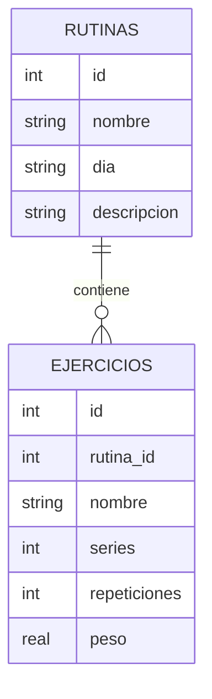

La clave foránea `rutina_id` usa `ON DELETE CASCADE` y `PRAGMA foreign_keys = ON`: al eliminar una rutina se eliminan sus ejercicios.

## Arquitectura

```
lib/
├── main.dart            # MultiProvider + MaterialApp (Material 3)
├── models/              # Rutina, Ejercicio, ResumenRutina (toMap / fromMap)
├── db/                  # DatabaseHelper (singleton, onCreate, semilla)
├── providers/           # RutinaProvider, EjercicioProvider, TemaProvider
├── screens/             # listado, detalle, formularios y resumen
└── widgets/             # tarjeta, estado vacío y diálogo reutilizables
```

Flujo de datos: **Pantalla → Provider → DatabaseHelper → SQLite**. Las pantallas nunca acceden a la base de datos ni manipulan `Map` crudos.

## Capturas

| Listado y buscador | Búsqueda | Validación |
|---|---|---|
| 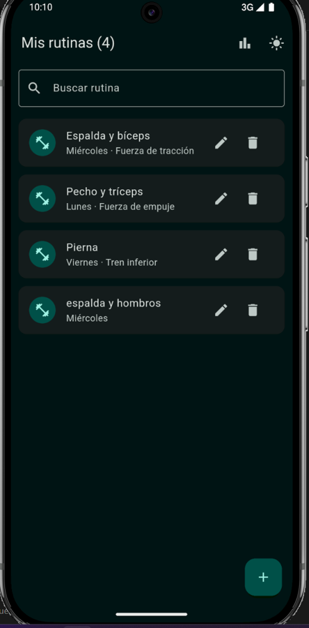 | 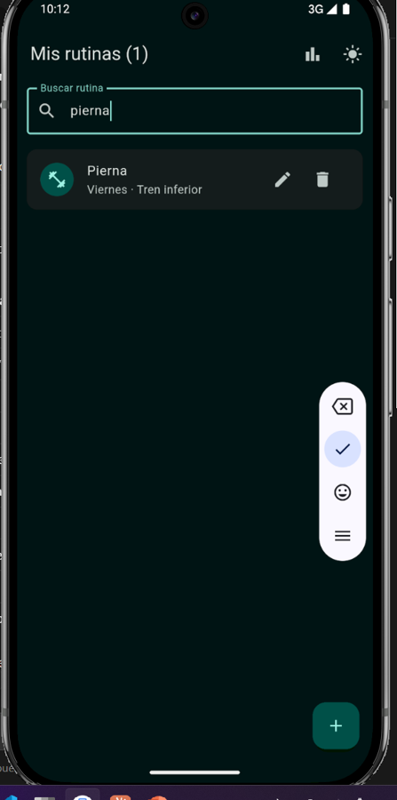 | 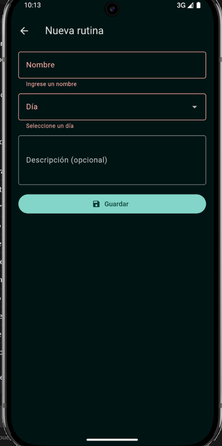 |

| Confirmar eliminación | SnackBar | Detalle de rutina |
|---|---|---|
| 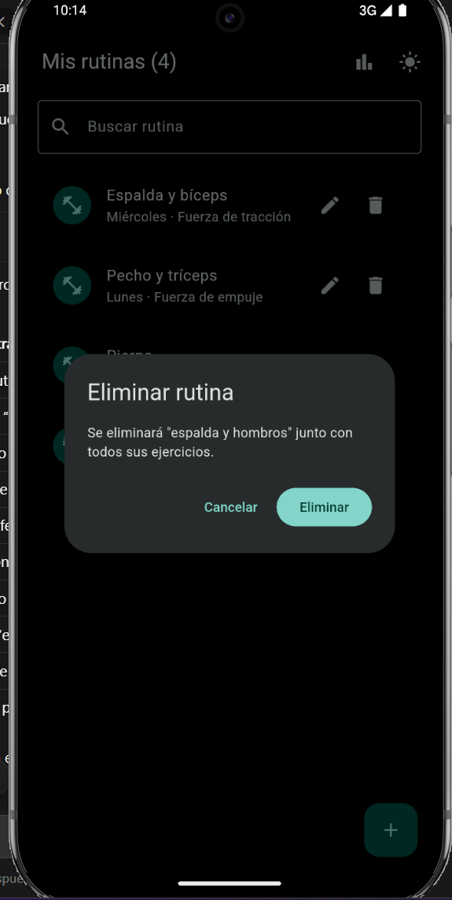 | 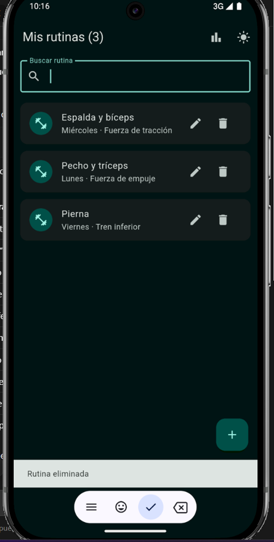 | 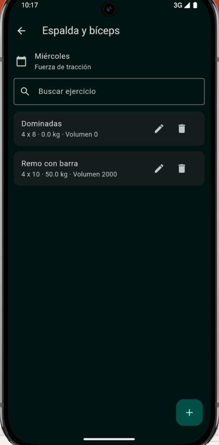 |

| Formulario de ejercicio | Estado vacío | Resumen |
|---|---|---|
| 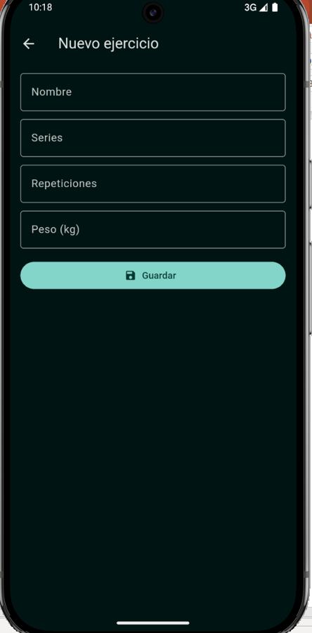 | 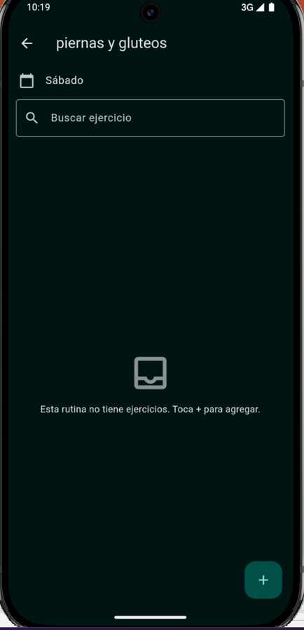 | 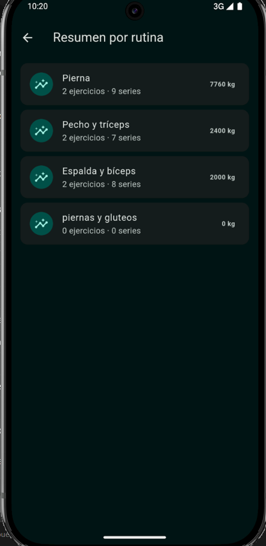 |

| Tema claro |
|---|
| 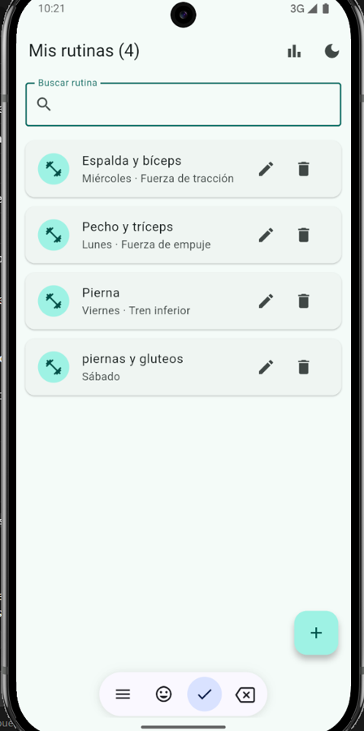 |

## Cómo ejecutarla

Requisitos: Flutter (canal estable) y un emulador o dispositivo **Android** (sqflite no funciona en web).

```bash
git clone https://github.com/Remmy002/inf662-ti2-moreira.git
cd inf662-ti2-moreira
flutter pub get
flutter run
```

## APK

- **APK:** disponible en [Releases](https://github.com/Remmy002/inf662-ti2-moreira/releases/tag/v1.0).
